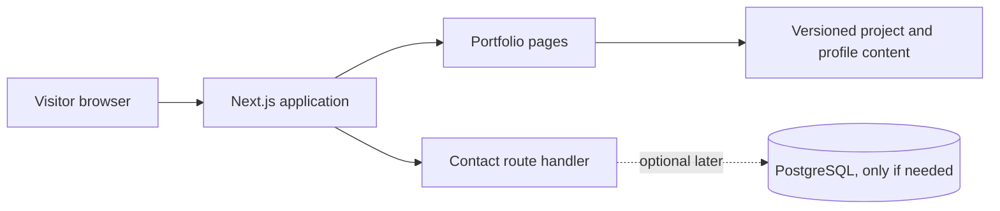
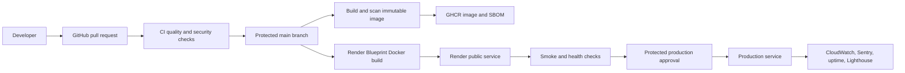

# Initial architecture

## Application shape

Use one Next.js App Router application with TypeScript. Keep portfolio content as repository-managed data until there is a concrete need for a CMS or database. The contact flow uses a Next.js route handler with server-side validation, a honeypot, and a bounded in-memory rate limiter. Resend delivers messages when configured; contact messages are not stored in an application database. The in-memory limiter is best-effort for a single process and should be replaced with shared storage before running multiple instances. PostgreSQL is optional and intentionally deferred.



## Delivery target

The deployment target is a containerized Next.js web service on Render, configured with a Blueprint in `render.yaml`. Render builds the Dockerfile from the connected GitHub repository in Singapore, uses `/api/health` as its readiness check, and auto-deploys after connected checks pass. The generated `onrender.com` URL is sufficient until a custom domain is available. The Free plan is intended for initial preview and may sleep when idle; upgrade before expecting production uptime.



## Decisions and rationale

| Decision | Rationale |
| --- | --- |
| Next.js App Router + TypeScript | One application can serve the portfolio and later contact endpoint without creating microservices. |
| Tailwind CSS | Responsive styling can evolve with the site without introducing a separate component framework in Phase 1. |
| Versioned project content | The initial portfolio is small, reviewable in Git, and does not need a database or CMS. |
| ECS Fargate as the learning target | It demonstrates container delivery and cloud operations without running Kubernetes nodes. |
| No database initially | Contact messages can use a managed email provider or another narrowly scoped store if needed; PostgreSQL is not justified until a real requirement appears. |
| Cost review before provisioning | ECS, load balancers, NAT gateways, logs, and DNS can incur charges. Cloud resources should be estimated and budgeted before Terraform apply. |
| Real signals only | The engineering page must not present sample values as live monitoring data. |

## Planned repository growth

```text
src/app/                 Routes, layouts, and global styles
src/components/          Shared UI components (as pages are built)
src/content/              Typed portfolio content
public/                   Images and supplied resume PDF
tests/                    Vitest unit and Playwright browser coverage
.github/workflows/        Pull-request CI; release workflows follow in later phases
terraform/                Cloud infrastructure modules (later phase)
monitoring/               Dashboard and alert definitions (later phase)
docs/                     Architecture, decisions, and runbooks
```

Phase 5 includes the `Dockerfile`, `compose.yaml`, Dependabot updates, secret scanning, container vulnerability scans, an SBOM artifact, and GHCR publishing. The Render Blueprint now defines the initial public service; it still needs to be created from the Render Dashboard. Production plan selection, a custom domain, Resend sender verification, shared rate limiting, and monitoring remain future work.
